<p align="center">
  
</p>
# Socket.IO (`/socket.io`)

Socket.IO — **альтернативный транспорт** для realtime-событий. Работает параллельно
с raw WebSocket (`/ws`) и отдаёт **те же самые события**.

> Отключается флагом `SOCKETIO_ENABLED=false` (по умолчанию включён).

---

## 1. Подключение

**URL:** `ws://localhost:8080/socket.io/`

**Аутентификация:** access-токен в query-параметре `token` (или `access_token`):

```text
ws://localhost:8080/socket.io/?token=<access_token>&EIO=3&transport=websocket
```

| Параметр | Значение | Зачем |
|-----------|----------|-------|
| `token` | `<access_token>` | JWT пользователя |
| `EIO` | `3` | Engine.IO v3 (протокол Socket.IO v2) |
| `transport` | `websocket` | транспорт (без polling) |

Заголовок `Authorization: Bearer` тоже поддерживается, но в браузере WebSocket
не умеет его слать — поэтому используйте query.

---

## 2. Handshake

Сервер отвечает engine.io-пакетом `open`:

```text
0{"sid":"1","upgrades":[],"pingInterval":20000,"pingTimeout":60000}
```

Далее:

| Кадр | Кто шлёт | Смысл |
|------|----------|-------|
| `2` | клиент → сервер | probe (ping) |
| `3` | сервер → клиент | probe ok (pong) |
| `40` | клиент → сервер | подключение к namespace `/` |
| `40` | сервер → клиент | подтверждение namespace |
| `42["<event>",{...}]` | сервер → клиент | событие |
| `3` | клиент → сервер | ответ на ping сервера |

Каждому подключённому пользователю автоматически выдаётся приватная комната
`u:<userID>`, поэтому события приходят только адресату.

---

## 3. Пример (JavaScript, socket.io-client@2.x)

```js
import { io } from "socket.io-client";

const socket = io("http://localhost:8080/socket.io", {
  query: { token: accessToken },
  transports: ["websocket"],
});

socket.on("connect", () => console.log("connected", socket.id));
socket.on("message.new", (msg) => console.log("новое сообщение", msg));
socket.on("message.typing", (p) => console.log("печатает", p));
socket.on("call.started", (call) => console.log("звонок", call));
```

---

## 4. Postman

В коллекции `postman/Jeogram API.postman_collection.json` → папка
**«12. Realtime — WebSocket и Socket.IO»**:

1. Откройте `Socket.IO /socket.io — подключение (протокол v2 / Engine.IO v3)`
2. Нажмите **Connect** (Postman откроет вкладку WebSocket)
3. Отправьте в поле Message кадр `40` — сервер ответит `40` (ack)
4. Выполните в соседней вкладке `06. Messages → Отправить сообщение` —
   придёт кадр `42["message.new",{...}]`

---

## 5. События

События полностью совпадают с raw WebSocket (`/ws`) — см. таблицу в
[WEBSOCKET.md](WEBSOCKET.md):

`message.new`, `message.edited`, `message.deleted_for_all`, `message.typing`,
`user_status`, `call.started`, `call.signal`, `call.joined`,
`call.participant_muted`, `admin.broadcast`.

---

## 6. Отключение

```bash
SOCKETIO_ENABLED=false
```

или в `docker-compose.yml`:

```yaml
environment:
  SOCKETIO_ENABLED: "false"
```

Маршрут перестанет существовать, `/ws` продолжит работать.
